<div align="center">

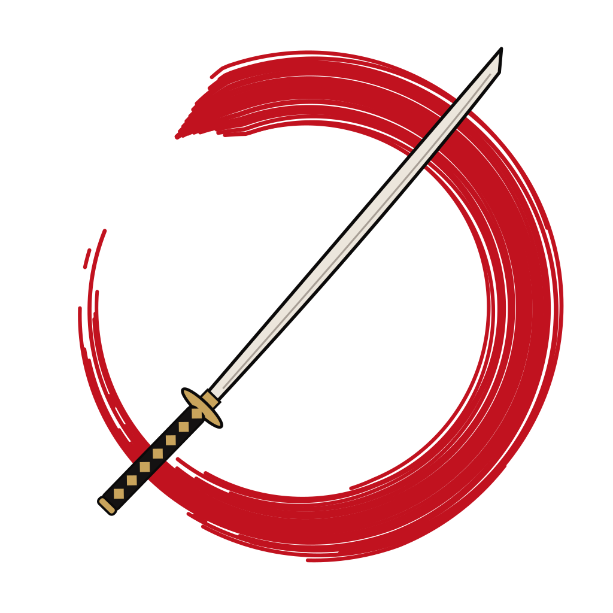

# Ghost of Tsushima for macOS

### 風が導く
*The wind will guide you.*

Sumi-e ink, washi paper, lacquer red and gold leaf, carried through your whole Mac:
terminals, prompt, editor, menu bar, window borders and six wallpapers painted entirely from code.

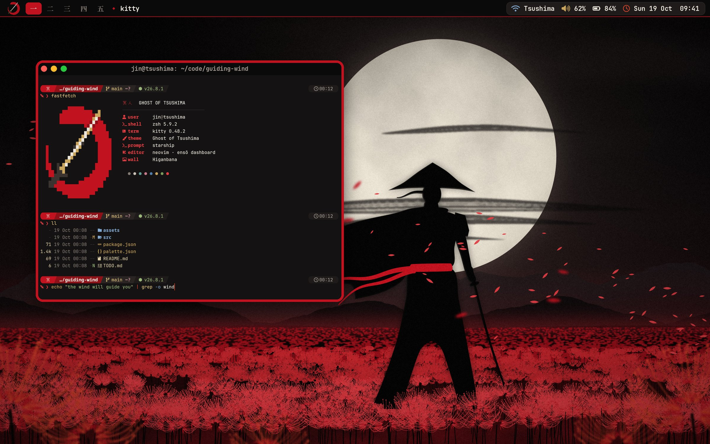

<sub>Preview render: terminals captured live in kitty, macOS chrome and the SketchyBar bar composited from the configs' own colours.</sub>

</div>

## What's inside

| Component | Description |
|---|---|
| **Wallpapers** | Six original scenes painted by [`src/wallpapers.py`](src/wallpapers.py) at your screen's exact resolution: *Higanbana*, *Torii at Dawn*, *Standoff*, *Kurosawa*, *Guiding Wind* and a light *Guiding Wind (paper)*. Plus a picker for top-rated 4K fan art from wallhaven |
| **Emblem** | A red ensō brush circle cut by a katana, drawn bristle by bristle as pure SVG ([`assets/emblem.svg`](assets/emblem.svg)) |
| **Terminal.app** | A real profile (`NSKeyedArchiver` colour blobs), imported and set as the default for new windows |
| **iTerm2** | `.itermcolors` preset and a Dynamic Profile with font, margins and blur |
| **Ghostty** | Theme and config: tab titlebar, padding, blur, a bar cursor, and Ghostty's ghost icon recoloured paper-on-ink |
| **kitty** | Theme and a full mac-friendly `kitty.conf`: slanted powerline tabs, a red cursor trail, Option as Alt |
| **Alacritty, WezTerm** | TOML theme with a ready config, and a complete `wezterm.lua` |
| **Shell** | A powerline [starship](https://starship.rs) prompt with 冥 and a katana, zsh syntax highlighting and autosuggestion colours, `fzf`, `eza`, `bat` and `less` colours |
| **Neovim** | `ghost-of-tsushima` colorscheme (treesitter, LSP, telescope, neo-tree, lualine, bufferline, which-key) and a full lazy.nvim config with a half-block ensō dashboard |
| **CLI tools** | fastfetch (with the ensō as a truecolor logo), btop, bat (`.tmTheme`), delta, lazygit |
| **Menu bar** | [SketchyBar](https://github.com/FelixKratz/SketchyBar): an ink bar with a red ensō, spaces numbered 一 二 三 in kanji, the front app, and Wi-Fi, volume, battery and clock in one capsule |
| **Window borders** | [JankyBorders](https://github.com/FelixKratz/JankyBorders): lacquer red around the focused window, ash for the rest |
| **macOS appearance** | Dark mode, red accent and red highlight colour, optional Dock and Finder tidying. Every change is recorded and reversible |
| **VS Code / Cursor** | `workbench.colorCustomizations` and token colours in [`vscode/settings.json`](vscode/settings.json) |

Every colour comes from one file, [`palette.json`](palette.json). The configs are generated from it, so re-tuning the theme is one edit and one command.

## Screenshots

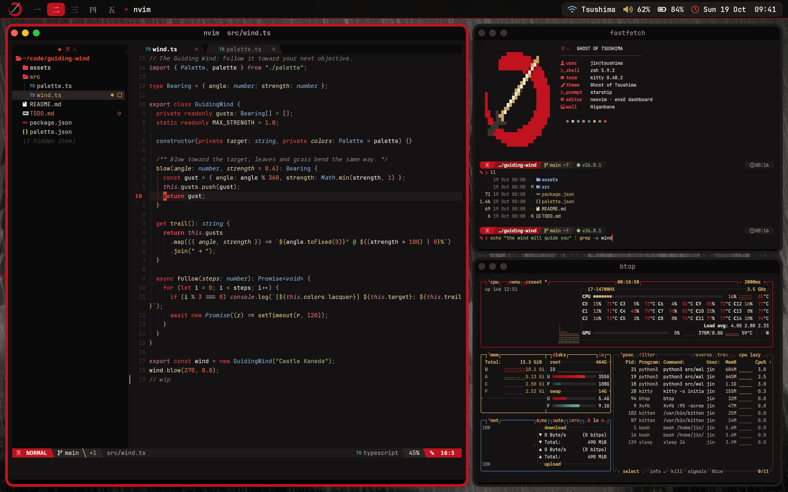
<p align="center"><sub>Neovim with neo-tree, bufferline and lualine; fastfetch; btop. Wallpaper: <i>Kurosawa</i></sub></p>

<table>
<tr>
<td>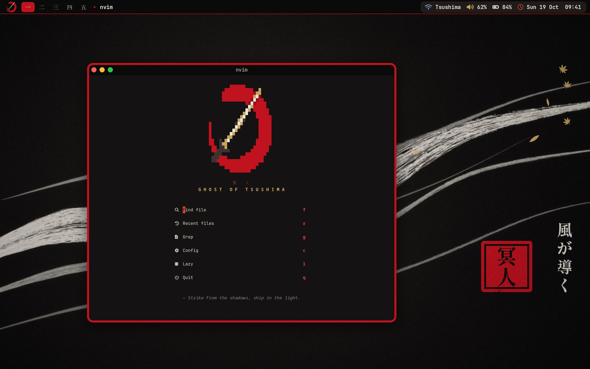</td>
<td>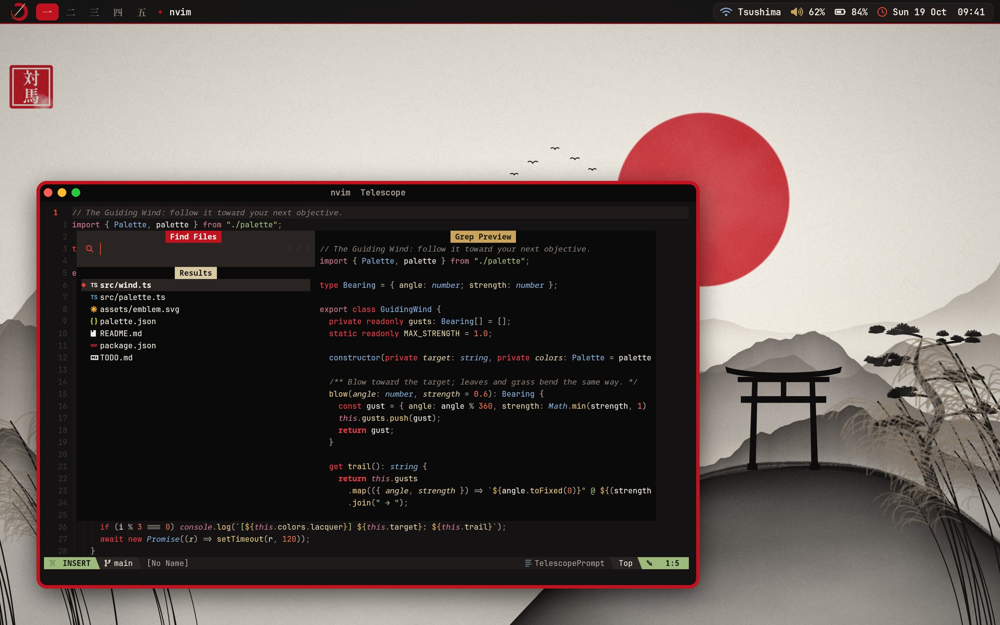</td>
</tr>
<tr>
<td align="center"><sub>The ensō dashboard. <i>Guiding Wind</i></sub></td>
<td align="center"><sub>Telescope. <i>Torii at Dawn</i></sub></td>
</tr>
<tr>
<td>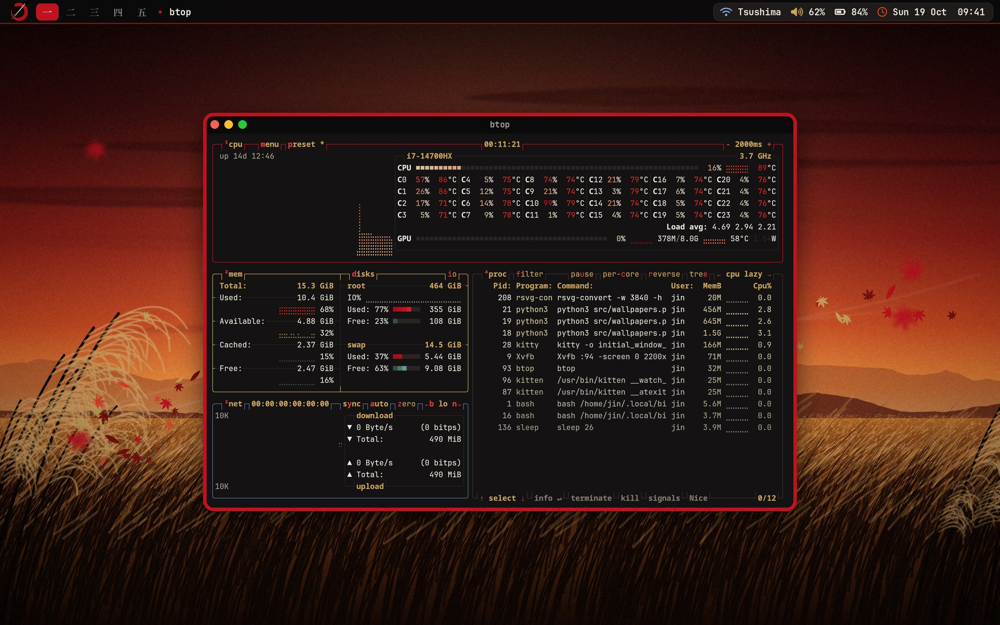</td>
<td>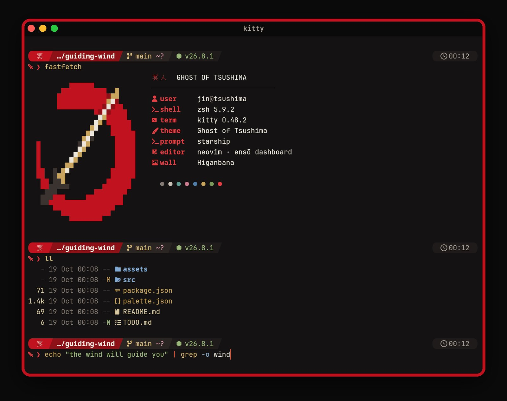</td>
</tr>
<tr>
<td align="center"><sub>btop watching the wallpapers render. <i>Standoff</i></sub></td>
<td align="center"><sub>starship, fastfetch, eza and zsh highlighting in kitty</sub></td>
</tr>
</table>

<details>
<summary><b>How these were made</b></summary>

These are **preview renders (terminal captured live, macOS chrome composited)**. Every terminal frame is a real capture of kitty running the theme's own configs, starship, fastfetch, Neovim and btop. The captures ran in a sandbox with a throwaway home, user and hostname, so no personal details appear. The macOS parts (menu bar, window chrome, traffic lights, borders) are drawn by [`src/previews.py`](src/previews.py) from the same colours and items as the SketchyBar and JankyBorders configs.
</details>

## Wallpapers

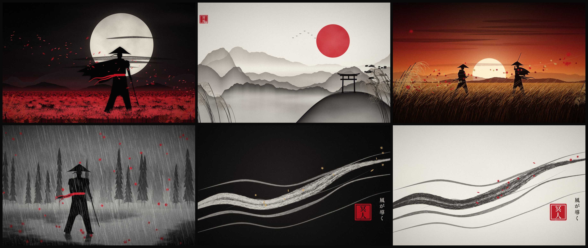

<p align="center"><sub><i>Higanbana</i> · <i>Torii at Dawn</i> · <i>Standoff</i> · <i>Kurosawa</i> · <i>Guiding Wind</i> · <i>Guiding Wind (paper)</i></sub></p>

The originals are painted by code: ink-wash ridgelines that dissolve into mist, a bristle brush with dry "flying white" strokes, hand-drawn samurai silhouettes, spider lilies with curling petals and stamens, film grain and a vignette. Nothing is bundled as an image. Render the scenes you like at exactly your screen's resolution, or pull official-style 4K art from wallhaven, with one script:

```bash
python3 scripts/wallpapers.py                 # interactive: pick by number, then set one as your desktop
python3 scripts/wallpapers.py --list          # show both catalogs
python3 scripts/wallpapers.py --originals all # paint all six at your screen size (5K, 6K, ultrawide...)
python3 scripts/wallpapers.py --get 1,4,9     # mix originals and wallhaven picks by number
python3 scripts/wallpapers.py --wallhaven 10  # the 10 most-favourited Ghost of Tsushima wallpapers
python3 scripts/wallpapers.py --originals Kurosawa --res 5120x2880 --set-first
python3 scripts/wallpapers.py --set ~/Pictures/Wallpapers/GhostOfTsushima/wallhaven-e7vgml.jpg
```

Files land in `~/Pictures/Wallpapers/GhostOfTsushima/`. On macOS the default render size is read from `system_profiler`. Painting the originals needs `pip3 install numpy pillow` and `brew install librsvg`; the script tells you if anything is missing. The wallhaven side uses only the Python standard library. It searches SFW, landscape images of at least 3840×2160, sorted by favourites, skips off-topic results, backs off politely on rate limits, and writes a `CREDITS.txt` with every link, uploader and source next to the downloads.

### With official-style art

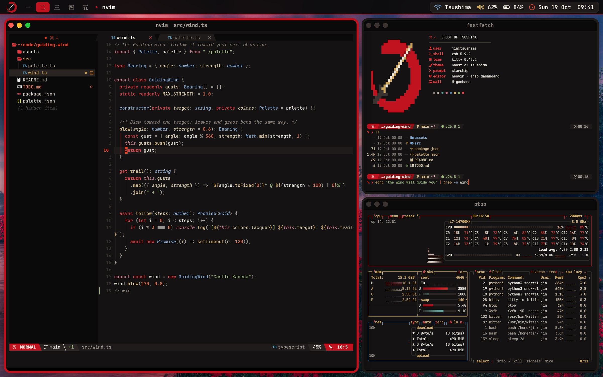
<sub>Wallpaper: [wallhaven e7vgml](https://wallhaven.cc/w/e7vgml), uploaded by [HKkkkkkkkk](https://wallhaven.cc/user/HKkkkkkkkk) (no source given)</sub>

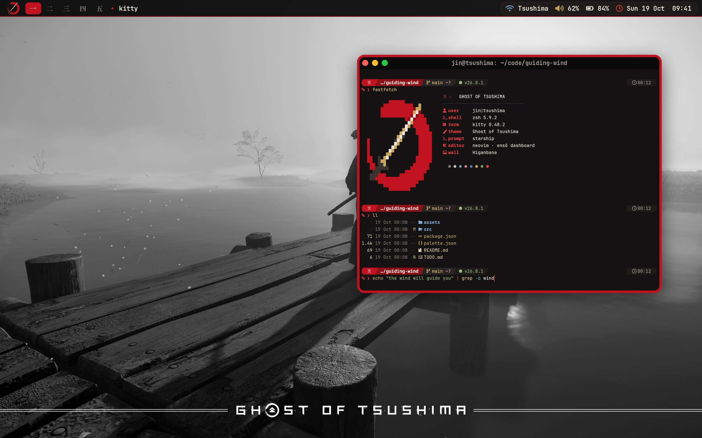
<sub>Wallpaper: [wallhaven rdpd9w](https://wallhaven.cc/w/rdpd9w), uploaded by [Hellsingexe](https://wallhaven.cc/user/Hellsingexe) (no source given)</sub>

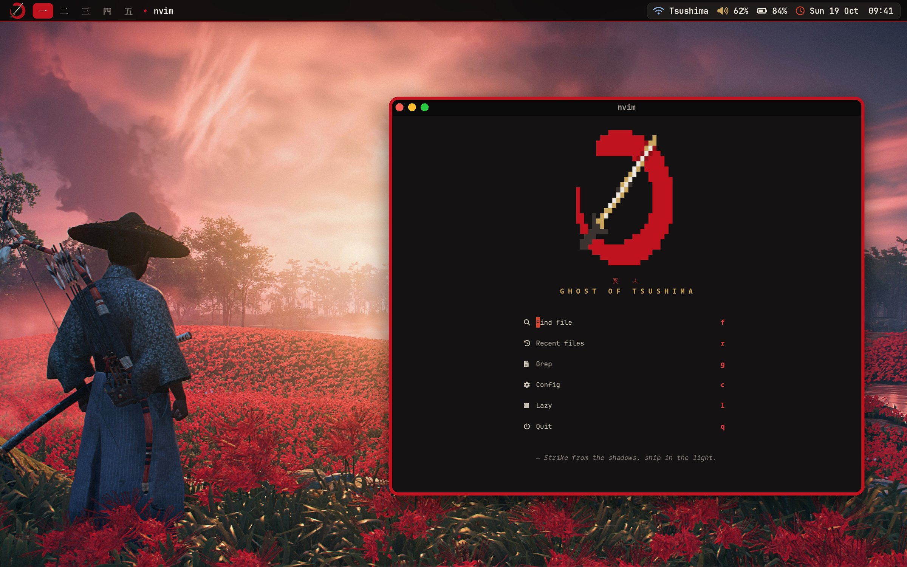
<sub>Wallpaper: [wallhaven g72wqd](https://wallhaven.cc/w/g72wqd), official art via [Sucker Punch Productions](https://www.suckerpunch.com/category/game/ghostoftsushima/), uploaded by [Konozettoda](https://wallhaven.cc/user/Konozettoda)</sub>

All rights to this artwork belong to its artists and to Sucker Punch Productions / Sony Interactive Entertainment. It is not part of this repository. If one of these is yours and you would like it credited differently or removed, please open an issue.

## Install

Requirements: macOS 14 or newer and [Homebrew](https://brew.sh). Everything below is optional and component by component.

```bash
git clone https://github.com/Shubhwtf/ghost-of-tsushima-theme-mac.git
cd ghost-of-tsushima-theme-mac

./install.sh --brew --all --wallpaper Higanbana   # tools, every component, and a wallpaper
```

Or pick what you want:

```bash
./install.sh --terminal     # Terminal.app, iTerm2, Ghostty, kitty, Alacritty, WezTerm, btop, bat, delta, lazygit, fastfetch
./install.sh --shell        # starship, zsh highlighting + autosuggestions, fzf, eza
./install.sh --nvim         # the Neovim config
./install.sh --desktop      # SketchyBar, JankyBorders, dark mode + red accent (add --extras for Dock/Finder)
./install.sh --brew         # sketchybar, borders, starship, fastfetch, btop, bat, delta, eza, fzf, lazygit,
                            # neovim, zsh plugins, JetBrains Mono Nerd Font, Ghostty
./install.sh --wallpaper Kurosawa   # or a number from scripts/wallpapers.py --list, or an image path
```

Before it changes anything, the installer copies every config it touches to `~/.got-backup-<timestamp>`. Existing configs are moved there, never deleted. On Linux it installs only the cross-platform parts (terminals, shell, Neovim) and skips the macOS layer.

<details>
<summary><b>Terminals</b></summary>

- **Terminal.app**: the profile is imported with `open` and set as the default and startup profile. A themed window opens once during the import; new windows use it from then on. Or double-click [`terminal/terminal-app/Ghost of Tsushima.terminal`](terminal/terminal-app) yourself.
- **iTerm2**: the Dynamic Profile appears as *Ghost of Tsushima* in *Settings › Profiles*. Pick *Other Actions › Set as Default*. The colours alone are in [`Ghost of Tsushima.itermcolors`](terminal/iterm2) (*Colors › Color Presets › Import*).
- **Ghostty**: `~/.config/ghostty/config` and `themes/ghost-of-tsushima`.
- **kitty**: `~/.config/kitty/kitty.conf` includes `themes/ghost-of-tsushima.conf`.
- **Alacritty**: `~/.config/alacritty/themes/ghost-of-tsushima.toml`. If you already have an `alacritty.toml`, add `[general] import = ["~/.config/alacritty/themes/ghost-of-tsushima.toml"]`.
- **WezTerm**: [`terminal/wezterm/wezterm.lua`](terminal/wezterm/wezterm.lua) is a complete config. If you already have one, it is installed next to yours as `ghost-of-tsushima.lua`.
- **btop**: `color_theme = "ghost-of-tsushima"`. **bat**: `BAT_THEME="Ghost of Tsushima"` (set by the zsh file). **delta**: included from `~/.gitconfig` as the `ghost-of-tsushima` feature. **lazygit**: installed as `config.yml` if you have none, otherwise next to it.
- **fastfetch**: `~/.config/fastfetch/config.jsonc` with the ensō logo in `ghost.ansi`.
</details>

<details>
<summary><b>Shell</b></summary>

`--shell` installs [`shell/starship.toml`](shell/starship.toml) to `~/.config/starship.toml` and adds one line to `~/.zshrc` that sources [`shell/ghost-of-tsushima.zsh`](shell/ghost-of-tsushima.zsh). That file holds the colours for zsh-syntax-highlighting and zsh-autosuggestions, `FZF_DEFAULT_OPTS`, `EZA_COLORS`, `BAT_THEME`, `LESS_TERMCAP_*` and BSD `ls`, then starts starship. Set `GOT_NO_STARSHIP=1` to keep your own prompt.
</details>

<details>
<summary><b>Neovim</b></summary>

[`dotfiles/nvim`](dotfiles/nvim) is a complete lazy.nvim config for Neovim 0.11+: telescope, the `main` branch of nvim-treesitter, neo-tree v3, lualine with slanted separators, bufferline, an alpha dashboard with the half-block ensō, gitsigns, which-key, indent guides and autopairs. It needs a Nerd Font and the tree-sitter CLI (`brew install tree-sitter`).

Only want the colours? Copy `colors/ghost-of-tsushima.lua`, `lua/got` and `lua/lualine/themes` into your config and run `:colorscheme ghost-of-tsushima`.

| Key | Action |
|---|---|
| `Ctrl-p` / `Space f f` | find files |
| `Space f g` / `f b` / `f r` | grep / buffers / recent files |
| `Ctrl-n` | file tree |
| `Shift-h` / `Shift-l` | previous / next buffer |
</details>

<details>
<summary><b>Menu bar, borders and appearance</b></summary>

- **SketchyBar** (`~/.config/sketchybar`): the bar draws its own menu, so `--extras` also auto-hides the macOS menu bar. Clicking a kanji space focuses it through yabai if you have it, otherwise through Mission Control's *Ctrl+number* shortcuts (enable them in *System Settings › Keyboard › Keyboard Shortcuts › Mission Control*). The scripts only need `/bin/bash`, `pmset`, `osascript` and `networksetup`.
- **JankyBorders** (`~/.config/borders/bordersrc`): round, 5 pt, lacquer red when focused.
- **[`macos/defaults.sh`](macos/defaults.sh)**: dark mode, `AppleAccentColor = 0` (red), a red highlight colour and medium sidebar icons. `--extras` adds Dock auto-hide with no delay, no recent apps, the scale effect, and in Finder the path bar, status bar, file extensions and folders first. The old value of every key is written to `~/.got-backup-<timestamp>/restore-defaults.sh` before it is changed.
- **VS Code / Cursor**: merge [`vscode/settings.json`](vscode/settings.json) into your user settings.
</details>

## Uninstall

```bash
./uninstall.sh                  # restore your old configs and macOS settings
./uninstall.sh --keep-defaults  # same, but leave dark mode and the red accent on
```

The uninstaller moves the theme's files to `~/.got-removed-<timestamp>`, puts back the configs from your first `~/.got-backup-*`, removes the theme's lines from `~/.zshrc`, switches Terminal.app back to *Basic* and replays `restore-defaults.sh`. Nothing is deleted.

## Palette

| | Name | Hex | Contrast on background |
|---|---|---|---|
|  | Ink (bars, sidebars) | `#0b0a0a` | |
|  | Charcoal (terminal background) | `#141212` | |
|  | Ash (surfaces, inactive border) | `#1e1b1a` | |
|  | Stone | `#2a2523` | |
|  | Slate (borders) | `#3a3330` | |
|  | Smoke (comments) | `#837a73` | 4.4:1 |
|  | Mist (dim text) | `#a89f96` | 7.2:1 |
|  | Washi paper (text) | `#ece6dc` | 15.0:1 |
|  | Paper, bright | `#f6f1e7` | 16.6:1 |
|  | Blood (selection, with paper text at 8.3:1) | `#8e1118` | |
|  | Lacquer red (accent, focused border) | `#c1121f` | |
|  | Crimson (keywords, errors) | `#e23d43` | 4.4:1 |
|  | Vermilion (cursor) | `#e0452b` | 4.5:1 |
|  | Ember (numbers) | `#e8704a` | 6.1:1 |
|  | Gold leaf | `#c9a45c` | 8.0:1 |
|  | Gold, bright (functions) | `#e2c27f` | 10.9:1 |
|  | Pampas (parameters) | `#d8c9a3` | 11.4:1 |
|  | Ai-iro indigo | `#4f7ca8` | 4.2:1 |
|  | Sky (types) | `#82a9d1` | 7.6:1 |
|  | Bamboo | `#7a9a5a` | 5.9:1 |
|  | Moss (strings) | `#9db97c` | 8.6:1 |
|  | Sakura (imports) | `#c97a8d` | 5.9:1 |
|  | Patina | `#5f9c94` | 5.9:1 |
|  | Jade (escapes) | `#86c2b9` | 9.3:1 |

The 16 ANSI colours, in order: ash, crimson, bamboo, gold, indigo, sakura, patina, rice, then smoke, vermilion, moss, bright gold, sky, blossom, jade and bright paper.

## Building from source

Every config, the emblem and the wallpapers are generated from [`palette.json`](palette.json) by the scripts in [`src/`](src):

```bash
python3 src/terminals.py     # Terminal.app, iTerm2, Ghostty, kitty, Alacritty, WezTerm, btop, bat, delta, lazygit
python3 src/shell.py         # starship, zsh colours, fastfetch and its logo
python3 src/nvim.py          # Neovim palette and the dashboard ensō
python3 src/desktop.py       # SketchyBar, JankyBorders, VS Code
python3 src/emblem.py assets # emblem.svg / .png
python3 src/wallpapers.py --res 3840x2160 --out build/wallpapers   # all six scenes
python3 src/palette.py       # print the WCAG contrast of every colour
```

They need Python 3.10+, `numpy`, `pillow` and `rsvg-convert` (librsvg). `src/glyphs.py build` re-extracts the kanji outlines and needs `fonttools`.

<details>
<summary><b>What was tested where</b></summary>

Tested on Linux:

- every generated file parses: the Terminal.app plist and each colour blob round-trip through `plistlib`, plus TOML, JSON, YAML and the `.tmTheme`
- `kitty.conf` loads with kitty's own parser
- Neovim starts headless with no messages, and its plugins and parsers install
- all shell scripts pass `bash -n` and shellcheck
- an install and uninstall round trip in a throwaway home restores every original file

Written against the documented APIs but not yet run on a real Mac: the SketchyBar items, the Terminal.app import, and the `defaults` keys. Issues and fixes are welcome.
</details>

## Credits

- Fan-made, non-commercial tribute to *Ghost of Tsushima* by Sucker Punch Productions, published by Sony Interactive Entertainment. Not affiliated with or endorsed by them. All artwork in this repository is original and drawn from code.
- Kanji outlines from [Shippori Mincho](https://github.com/fontdasu/ShipporiMincho) by the Shippori Mincho Project Authors, SIL Open Font License 1.1 ([`fonts/`](fonts)).
- [JetBrains Mono](https://www.jetbrains.com/lp/mono/) (OFL) with [Nerd Fonts](https://www.nerdfonts.com) icons.
- [SketchyBar](https://github.com/FelixKratz/SketchyBar) and [JankyBorders](https://github.com/FelixKratz/JankyBorders) by Felix Kratz, [starship](https://starship.rs), [fastfetch](https://github.com/fastfetch-cli/fastfetch), [btop](https://github.com/aristocratos/btop) and the Neovim plugin authors.
- Wallpaper search by [wallhaven](https://wallhaven.cc). Fan art belongs to its artists (see above).
- Sister theme: [Attack on Titan for KDE Plasma](https://github.com/Shubhwtf/aot-theme-kde).

Licensed under the [GPL-3.0](LICENSE).
